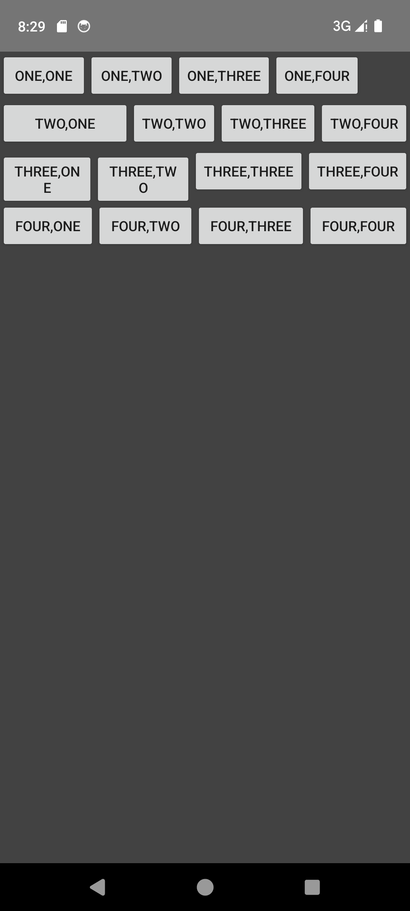
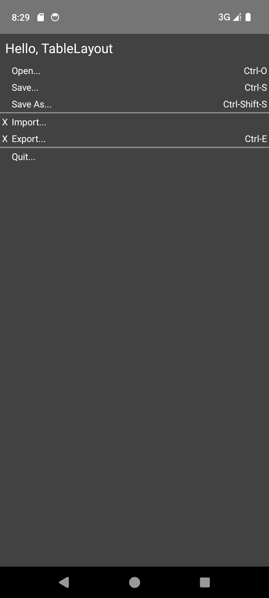
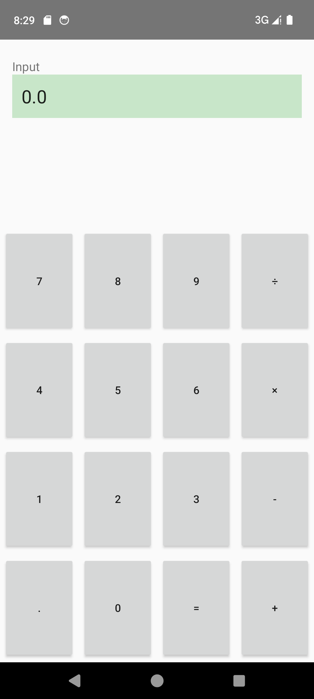
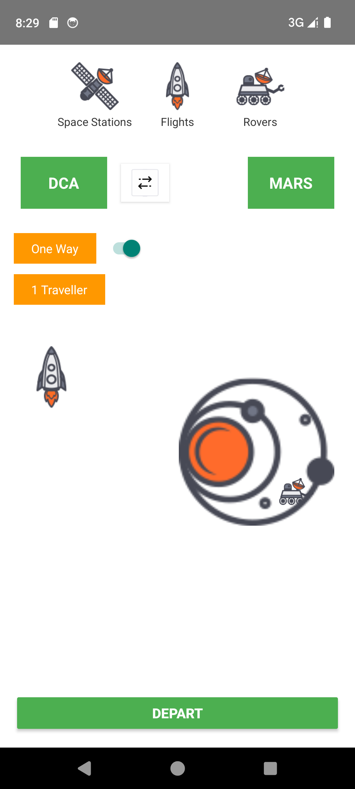
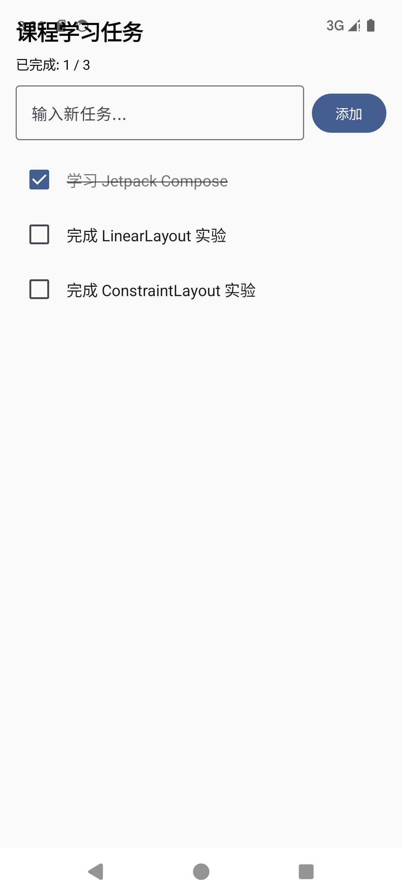

# 实验二：Android 界面布局

[返回仓库导航](../README.md) · [查看实验三](../experiment03/README.md)

以下五项均为实验二内的任务，分别展示 XML 布局和 Jetpack Compose。

## 任务与代码索引

| 任务 | Activity 源码 | 布局或实现 | 人工检查步骤 |
| --- | --- | --- | --- |
| 2.1 线性布局 | [LinearLayoutActivity.kt](src/main/java/com/example/test/LinearLayoutActivity.kt) | [activity_linear_layout.xml](src/main/res/layout/activity_linear_layout.xml) | 观察各行按钮方向、间距和权重分配 |
| 2.2 表格布局 | [TableLayoutActivity.kt](src/main/java/com/example/test/TableLayoutActivity.kt) | [activity_table_layout.xml](src/main/res/layout/activity_table_layout.xml) | 检查文字、快捷键列和分隔线对齐 |
| 2.3 约束布局计算器 | [CalculatorActivity.kt](src/main/java/com/example/test/CalculatorActivity.kt) | [activity_calculator.xml](src/main/res/layout/activity_calculator.xml) | 检查按钮网格，尝试加减乘除、清空、小数、除零 |
| 2.4 约束布局太空旅行 | [SpaceTravelActivity.kt](src/main/java/com/example/test/SpaceTravelActivity.kt) | [activity_space_travel.xml](src/main/res/layout/activity_space_travel.xml) | 检查顶部标签、DCA/MARS、箭头、叠加图片和底部按钮排列 |
| 2.5 Compose 任务列表 | [TaskListActivity.kt](src/main/java/com/example/test/TaskListActivity.kt) | 同文件 `TaskListScreen`、`TaskItem` | 输入并添加任务，勾选及取消，检查计数、删除线同步变化 |

入口：[MainActivity.kt](src/main/java/com/example/test/MainActivity.kt)；注册：[AndroidManifest.xml](src/main/AndroidManifest.xml)。图片、主题、图标均在本模块，无需跳转实验三。

## 运行

Android Studio 打开仓库根目录，选择 `experiment02` 运行。命令在**仓库根目录**执行：

```powershell
.\gradlew.bat :experiment02:assembleDebug
.\gradlew.bat :experiment02:installDebug
adb shell am start -n com.example.test.experiment02/com.example.test.MainActivity
```

桌面名称：**实验2 界面布局**。APK：`experiment02/build/outputs/apk/debug/experiment02-debug.apk`。

## 已有截图

以下是整理前仓库已有截图，仅作界面参考。

| 线性布局 | 表格布局 |
| --- | --- |
|  |  |

| 计算器 | 太空旅行 |
| --- | --- |
|  |  |



## 实现要点

- LinearLayout 以方向和 `layout_weight` 分配空间；TableLayout 通过 TableRow 组织行列。
- ConstraintLayout 示例通过约束关系、链和 Guideline 定位；太空旅行图片位于 `res/drawable`。
- Compose 任务列表用 `remember` 和 `mutableStateListOf` 管理状态，LazyColumn 显示条目，完成计数由任务状态派生。

上述人工检查步骤为待执行清单，实际验证范围见[整理记录](../docs/REORGANIZATION.md)。
