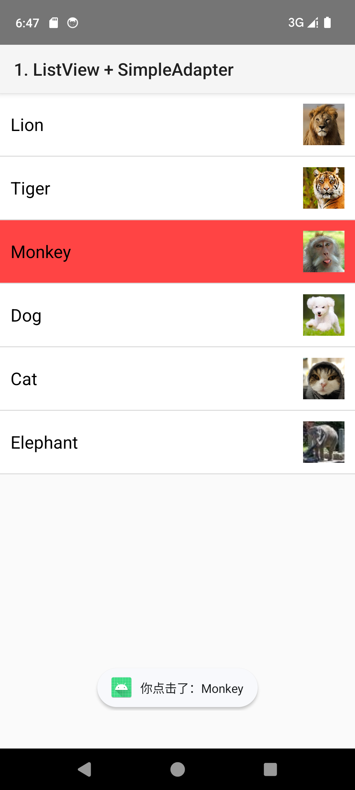
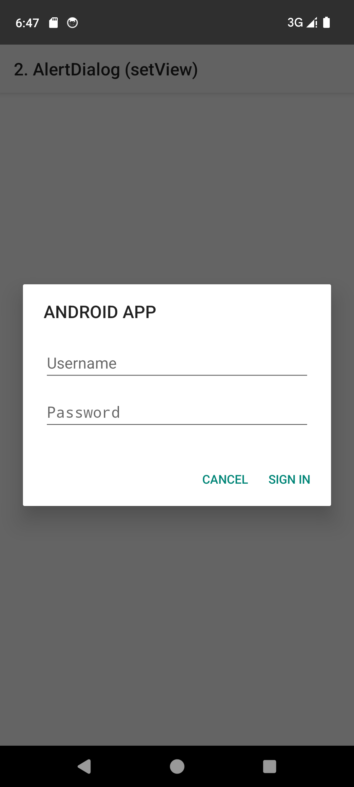
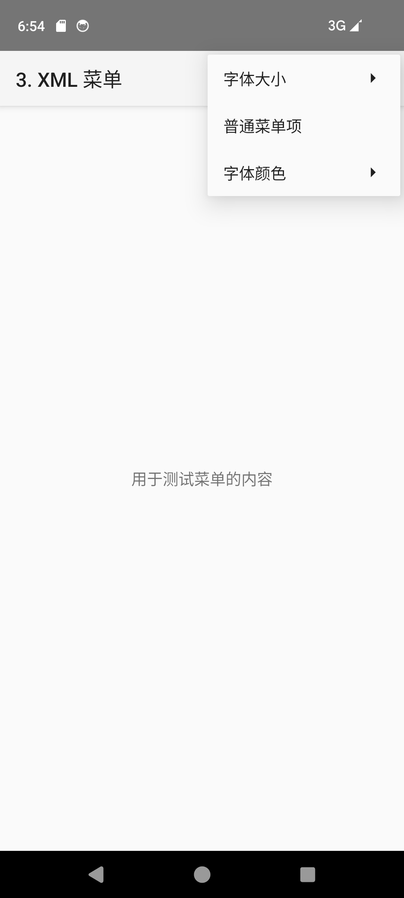
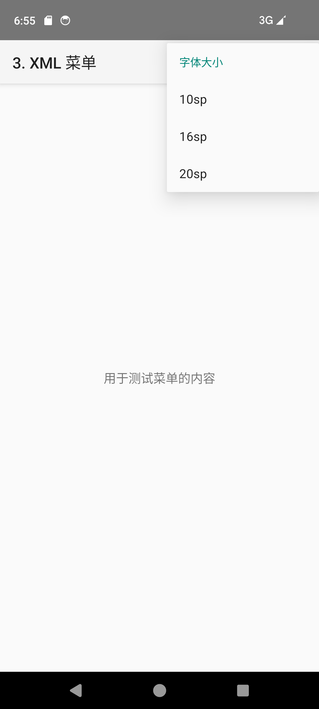
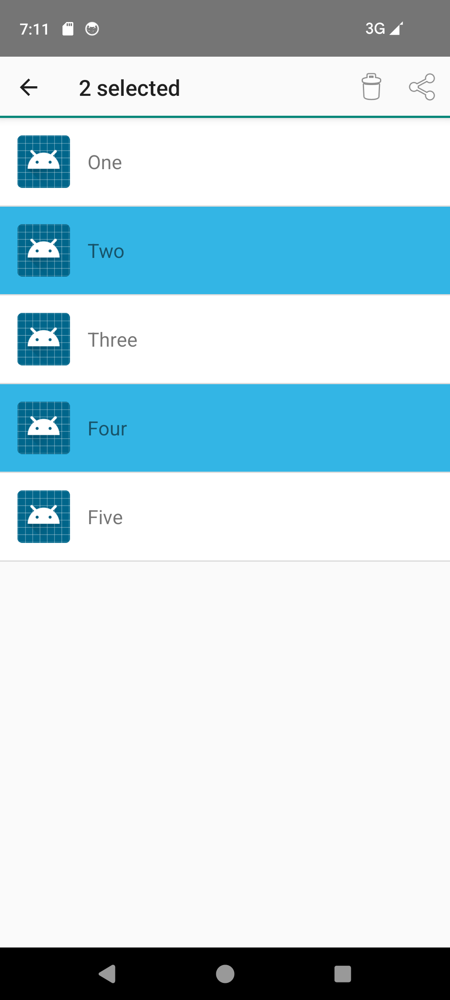
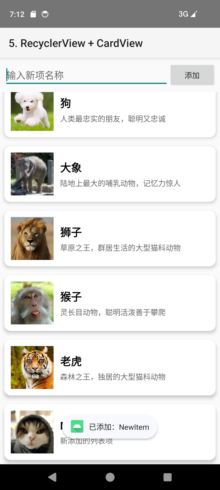

# 实验三：Android 界面组件

[返回仓库导航](../README.md) · [查看实验二](../experiment02/README.md)

本模块集中展示列表、对话框、菜单和多选交互，五项任务均从本模块首页进入。

## 任务与代码索引

| 任务 | Activity 源码 | 布局与菜单 | 人工检查步骤 |
| --- | --- | --- | --- |
| 3.1 ListView 动物列表 | [ListViewActivity.kt](src/main/java/com/example/test/ListViewActivity.kt) | [列表](src/main/res/layout/activity_list_view.xml) · [条目](src/main/res/layout/item_animal.xml) | 查看六种动物图文，点击条目，检查红色背景与 Toast |
| 3.2 自定义 AlertDialog | [AlertDialogActivity.kt](src/main/java/com/example/test/AlertDialogActivity.kt) | [页面](src/main/res/layout/activity_alert_dialog.xml) · [对话框](src/main/res/layout/dialog_login.xml) | 弹出对话框，用虚构数据检查输入、Sign in 提示和 Cancel 关闭 |
| 3.3 XML 选项菜单 | [MenuActivity.kt](src/main/java/com/example/test/MenuActivity.kt) | [页面](src/main/res/layout/activity_menu.xml) · [菜单](src/main/res/menu/menu_options.xml) | 打开菜单，切换 10/16/20sp 字体及黑红蓝颜色，点击普通菜单项 |
| 3.4 ActionMode 多选 | [ActionModeActivity.kt](src/main/java/com/example/test/ActionModeActivity.kt) | [列表](src/main/res/layout/activity_action_mode.xml) · [条目](src/main/res/layout/item_action_mode.xml) · [菜单](src/main/res/menu/menu_action_mode.xml) | 单击进入多选，检查蓝色背景和计数，取消选择、删除选中项，退出后检查状态清理 |
| 3.5 RecyclerView + CardView | [RecyclerViewActivity.kt](src/main/java/com/example/test/RecyclerViewActivity.kt) | [列表](src/main/res/layout/activity_recycler_view.xml) · [卡片](src/main/res/layout/item_card.xml) | 点击卡片，输入名称添加，检查滚动到新条目及空输入提示 |

入口：[MainActivity.kt](src/main/java/com/example/test/MainActivity.kt)；注册：[AndroidManifest.xml](src/main/AndroidManifest.xml)。动物图片、选择器位于本模块 `res/drawable`。

## 运行

Android Studio 打开仓库根目录，选择 `experiment03` 运行。命令在**仓库根目录**执行：

```powershell
.\gradlew.bat :experiment03:assembleDebug
.\gradlew.bat :experiment03:installDebug
adb shell am start -n com.example.test.experiment03/com.example.test.MainActivity
```

桌面名称：**实验3 界面组件**。APK：`experiment03/build/outputs/apk/debug/experiment03-debug.apk`，可与实验二同时安装。

## 已有截图

以下是整理前仓库已有截图，仅作界面参考。

| ListView | AlertDialog |
| --- | --- |
|  |  |

| XML 菜单 | 字体子菜单 |
| --- | --- |
|  |  |

| ActionMode | RecyclerView |
| --- | --- |
|  |  |

## 实际实现范围

- ListView 使用自定义 `BaseAdapter`，原首页的 `SimpleAdapter` 名称已修正。如果课程明确要求 SimpleAdapter，还需对照任务书核查。
- 菜单实现为 OptionsMenu 和字体、颜色子菜单。保留的 `menu_context.xml` 尚未接入 Activity，不能算已完成上下文菜单。
- AlertDialog 是本地界面演示，没有账户认证；ActionMode“分享”仅显示 Toast，没有调用系统分享。
- 本次整理不扩展实验业务功能。上述人工检查步骤为待执行清单，实际验证范围见[整理记录](../docs/REORGANIZATION.md)。
