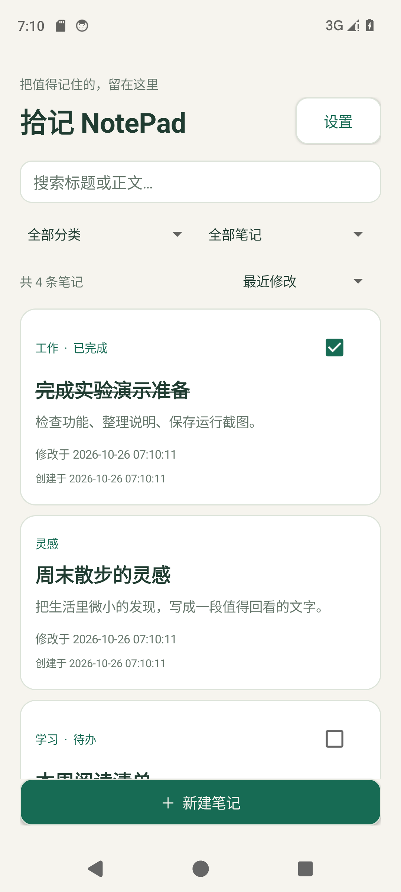
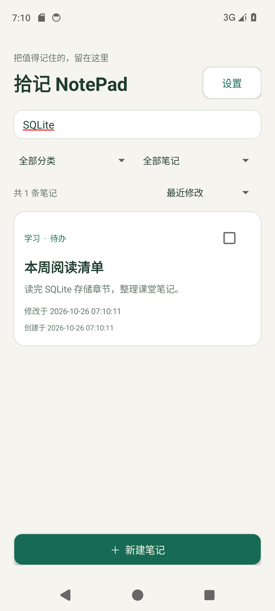
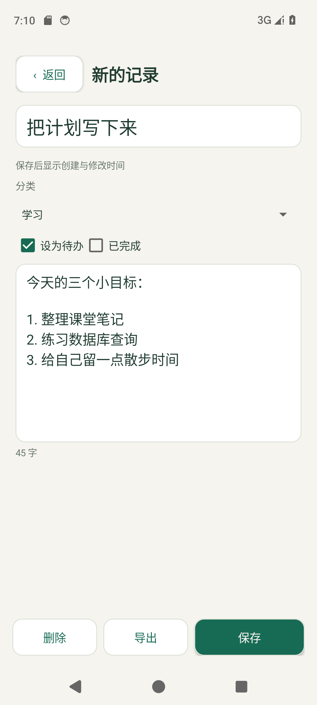
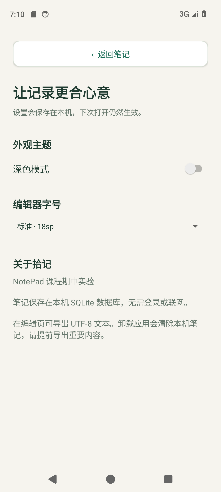
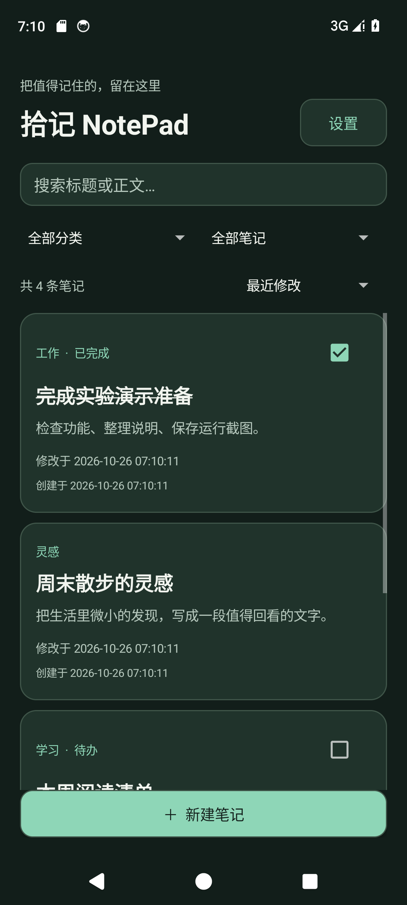
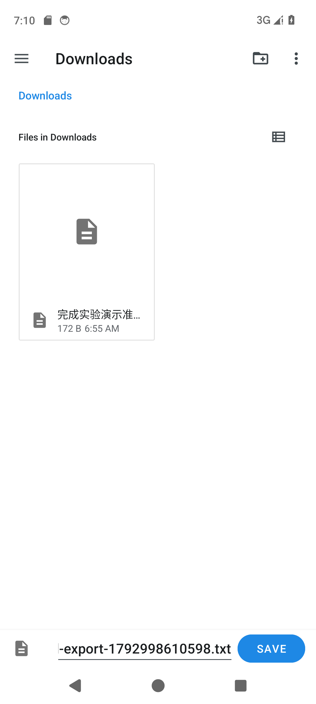

# 期中实验：NotePad 记事本应用

[返回课程仓库](../README.md) · [下载可安装 APK](download/NotePad-debug.apk) · [源码分析](docs/SOURCE_ANALYSIS.md) · [测试与验收记录](docs/VERIFICATION.md)

**拾记 NotePad** 基于课程指定的 [fjnu-cse/NotePad](https://github.com/fjnu-cse/NotePad) 扩展。保留并扩展原项目的数据契约、ContentProvider 和 SQLite 存储，重写列表和编辑界面。作为独立 `midterm-notepad` 应用模块，与实验二、三分别查看、运行和安装。

## 任务要求与完成对照

依据《期中实验_NotePad记事本应用.pdf》第 2 页：两项基本要求必须完成，附加功能至少两项。文档列举的图片、语音、OCR、云备份等是可选建议，并非全部必做。

| 类型 | 要求 / 本次实现 | 查看与操作入口 | 关键源码 |
| --- | --- | --- | --- |
| 必做 | 笔记条目显示时间戳 | 列表每条显示创建、修改时间，编辑后只刷新修改时间 | [NotesList](src/main/java/com/example/android/notepad/NotesList.java)、[Provider](src/main/java/com/example/android/notepad/NotePadProvider.java) |
| 必做 | 根据标题或内容查询 | 首页搜索框实时匹配标题或正文，清空恢复列表；支持中文和特殊字符字面查询 | [NotesRepository.list](src/main/java/com/example/android/notepad/NotesRepository.java) |
| 扩展 1 | 笔记分类 | 编辑页选择未分类/学习/工作/生活/灵感；首页按分类筛选 | [NoteEditor](src/main/java/com/example/android/notepad/NoteEditor.java)、[NotesList](src/main/java/com/example/android/notepad/NotesList.java) |
| 扩展 2 | 待办事项 | 笔记可设为待办，列表直接完成/取消；支持未完成、已完成筛选 | [NotesRepository.setDone](src/main/java/com/example/android/notepad/NotesRepository.java) |
| 扩展 3 | UI 美化和偏好设置 | 卡片列表、正文摘要、深浅主题、16/18/22sp 编辑字号，设置持久化 | [SettingsActivity](src/main/java/com/example/android/notepad/SettingsActivity.java)、[Ui](src/main/java/com/example/android/notepad/Ui.java)、[NotePreferences](src/main/java/com/example/android/notepad/NotePreferences.java) |
| 扩展 4 | 笔记排序 | 最近修改、最早创建、标题 A–Z，排序偏好持久化 | [NotesRepository](src/main/java/com/example/android/notepad/NotesRepository.java) |
| 扩展 5 | 导出笔记 | 已保存笔记通过系统文件选择器导出 UTF-8 `.txt`，包含正文、分类、时间和待办状态 | [NoteEditor.requestExport](src/main/java/com/example/android/notepad/NoteEditor.java)、[NotesRepository.exportText](src/main/java/com/example/android/notepad/NotesRepository.java) |

基础编辑功能包括新建、读取、修改、删除、空输入校验、正文自动生成标题、离开前未保存提示、删除二次确认、页面重建保留草稿。分类、状态、查询可组合使用；搜索没有结果时显示明确空状态。

## 运行截图

以下截图来自本次 Android 14 / API 34 模拟器实测，不是 PDF 中的示意图。演示笔记由测试临时创建，测试结束清理；新安装应用初始没有笔记。时间按设备时区显示，此次截图设备为 GMT。

| 列表和时间戳 | 正文查询 |
| --- | --- |
|  |  |

| 编辑、分类与待办 | 偏好设置 |
| --- | --- |
|  |  |

| 深色主题 | 系统文件导出 |
| --- | --- |
|  |  |

## 打开、构建和安装

用 Android Studio 打开**仓库根目录**，完成同步后选择运行模块 `midterm-notepad`。桌面名称为 **拾记 NotePad**，applicationId 为 `com.example.test.notepad`。

在仓库根目录执行：

```powershell
.\gradlew.bat :midterm-notepad:assembleDebug
.\gradlew.bat :midterm-notepad:installDebug
adb shell am start -n com.example.test.notepad/com.example.android.notepad.NotesList
```

构建产物位于 `midterm-notepad/build/outputs/apk/debug/midterm-notepad-debug.apk`。仓库另附[课堂演示安装包](download/NotePad-debug.apk)，使用 Android 调试签名，不作为商店发布包；[SHA-256 校验](download/SHA256SUMS.txt)可用于确认下载完整性。

环境：共用仓库 Gradle 9.5.0、AGP 9.3.0、JDK 25；compileSdk/targetSdk 37，minSdk 24，Java 11 源码。此模块采用 Android 原生 Java/View，不需要额外运行库。首次构建和 Lint 工具下载需要网络，缓存完整后可添加 `--offline --no-configuration-cache`。

## 建议老师按此顺序验收

1. 新建笔记“数据库复习”，正文填写“SQLite 的查询条件与参数绑定”，选择“学习”，保存。检查列表同时显示创建和修改时间。
2. 搜索“数据库”，应按标题找到；再搜索“SQLite”，应按正文找到。输入不存在的词，检查空状态；清空搜索，恢复列表。
3. 重新打开笔记修改正文并保存，检查创建时间保持不变、修改时间更新。
4. 新建工作类待办“准备演示”，在首页选择“工作”和“未完成待办”；点击卡片勾选框完成，条目应从未完成筛选中消失，在已完成筛选中可见。
5. 切换三种排序，检查顺序；进入设置切换深色模式、字号，重新打开应用确认偏好保留。
6. 在已保存、未修改的笔记编辑页点“导出”，选择文件位置并保存，用文本查看器确认中文正文与元信息；修改中的笔记需先保存再打开导出。
7. 新建草稿并输入内容，旋转屏幕确认不丢；按系统返回键分别检查“继续编辑”“放弃修改”“保存”。仅打开编辑页再返回，不应产生空笔记。
8. 删除已有笔记时先取消，确认数据仍在；再次确认删除，检查列表消失。

## 自动验证

```powershell
# 构建、静态检查、安装并运行20项设备测试，日志保存在build目录
powershell -ExecutionPolicy Bypass -File .\midterm-notepad\scripts\verify.ps1

# 多台设备时指定一台；SDK可从ANDROID_HOME或local.properties读取，也可显式指定
powershell -ExecutionPolicy Bypass -File .\midterm-notepad\scripts\verify.ps1 -DeviceSerial emulator-5554 -SdkPath D:\CodeTools\AndroidSDK
```

测试代码在 [NotePadTestRunner.java](src/androidTest/java/com/example/android/notepad/NotePadTestRunner.java)，使用 Android 自带 Instrumentation，在真实 SQLite、Activity 和系统文件界面上执行，无 JUnit 下载依赖。应在专用模拟器上复现；系统文件导出用例按本次 API 34 DocumentsUI 的 Downloads 路径核验。脚本不会清空应用数据，测试清理自己创建的记录和文件，并在结束时恢复测试前的偏好。完整结果见[验证记录](docs/VERIFICATION.md)。

## 数据与实现范围

- 笔记保存在应用私有 `note_pad.db` 中，数据库版本由原项目 2 升到 3，通过 `ALTER TABLE` 添加分类、待办列，保留原笔记及时间。该迁移针对同一数据库文件，不自动读取另一个安装包的私有数据。
- 内容在点击“保存”后入库；旋转/系统重建可恢复尚未保存草稿，不承诺强制停止或卸载后保留未保存编辑。
- 分类是五个预设分类；标题排序按 SQLite `NOCASE`，不是中文拼音排序。时间采用设备时间与时区，按秒显示。
- 实现的是单篇文本导出；没有云备份、批量恢复、语音、图片笔记、OCR 或桌面便签。上述功能不是本次选定扩展，不将其列为已实现。
- 当前完成了 API 34 模拟器实测和最低 API 静态检查，未声称覆盖所有厂商设备。应用不申请网络、麦克风或广泛存储权限；导出使用用户选择的文档 URI。

上游版本、复用与改动范围见[源码分析](docs/SOURCE_ANALYSIS.md)，许可见 [NOTICE](NOTICE) 和 [Apache 2.0 LICENSE](LICENSE)。
